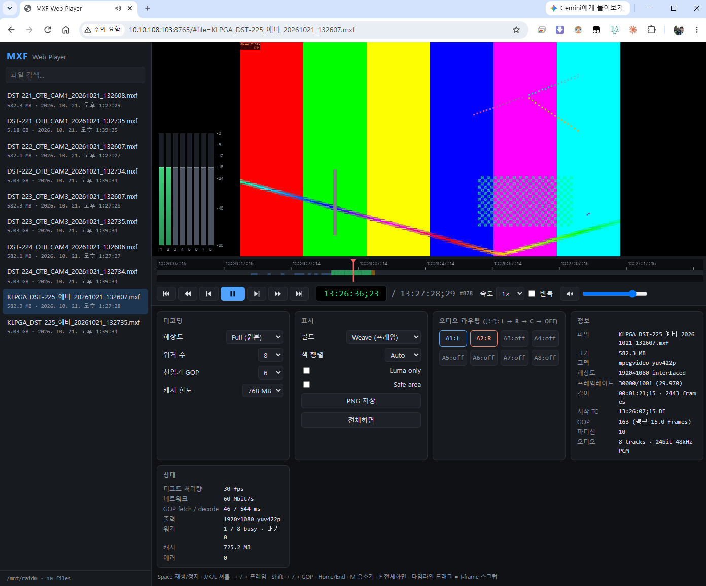

# MXF Web Player

Plays MXF files (XDCAM HD422 / IMX / long-GOP MPEG-2, plus best-effort H.264 and DNxHD) directly in the browser.
It does not transcode on the server. The browser fetches only the bytes it needs using HTTP Range requests.



```
python3 server.py --root /mnt/raid0 --port 8765
# open http://<server>:8765/
```

Requires Python 3 (standard library only) and a browser with WebGL2 and WebAssembly support (Chrome, Edge, Firefox or Safari 15+).

## How it works

```
 server.py ──Range──▶ mxf.js          RIP → partitions → IndexTableSegments → edit-unit → byte-offset table
                      player.js       GOP scheduling, cache, A/V clock, scrub
                        │  postMessage(GOP byte range)
                        ▼
                      decoder-worker.js × N   fetch(Range) → KLV unwrap → ffmpeg.wasm (-lowres) → raw YUV + PCM
                        │  transfer
                        ▼
                      renderer.js (WebGL2 YUV→RGB, bob)   +   WebAudio (track routing, meters)
```

* **Seek.** The player maps a frame to its GOP through the MXF index table, then to a byte range, and fetches that GOP with a single Range request (about 3 MB for 50 Mbit/s). A seek in a 5 GB file takes 0.3–0.7 s.
* **Scrub.** While you drag the timeline, the player fetches and decodes only the I-frame of each GOP at 1/4 resolution, which takes about 30–130 ms.
* **Parallel decode.** Each worker runs its own single-threaded ffmpeg core. The wasm module is compiled once and shared by all workers.
* **Half and Quarter quality.** These use the MPEG-2 decoder's `lowres` option, which decodes at reduced size and is much faster than decoding at full size and scaling down.
* **Audio.** PCM is unwrapped in JavaScript and scheduled through WebAudio sample-accurately against the video clock. Audio plays only at 1×.

## Keys

Space play/pause · J/K/L shuttle (−4…4×) · ←/→ frame · Shift+←/→ GOP · Home/End · M mute · F fullscreen.
Type a timecode (or a frame number) into the TC field and press Enter to jump there.

## Files

| file | role |
|---|---|
| `server.py` | static files, `/api/files` listing, `/media/<path>` with Range support |
| `public/js/mxf.js` | MXF partition and index-table parser that works over Range requests |
| `public/js/decoder-worker.js` | Range fetch, KLV demux, ffmpeg.wasm decode |
| `public/js/player.js` | GOP cache, worker pool, clock, audio |
| `public/js/renderer.js` | WebGL2 YUV renderer |
| `public/vendor/` | `@ffmpeg/core@0.12.10` (single-threaded UMD build) |
| `.claude/skills/mxf-web-player/` | Claude Code project skill (see below) |

## Claude Code skill

[`.claude/skills/mxf-web-player/SKILL.md`](.claude/skills/mxf-web-player/SKILL.md) records how to run, test and extend this player:

* MXF and ffmpeg.wasm facts learned while building it (index-table layout, KLV keys, core API)
* the verification procedure: headless Chromium driven over CDP, plus a frame-accuracy comparison against native ffmpeg
* baseline performance numbers
* extension points: new codecs, audio routing, cache invariants

Claude Code loads the skill automatically when you work in this repo. The bundled headless test driver can also be run by hand. It needs Python `websockets` and a Chromium binary, which it looks for in the `CHROME` environment variable or in Playwright's cache:

```bash
OUT_DIR=/tmp/check python3 .claude/skills/mxf-web-player/scripts/cdp.py \
  "http://localhost:8765/#file=<name>.mxf" wait:3 shot:loaded \
  "player.play(1).then(()=>1)" wait:5 \
  "JSON.stringify({f:player.frame,buf:player.buffering,err:player.stats.errors})"
```
